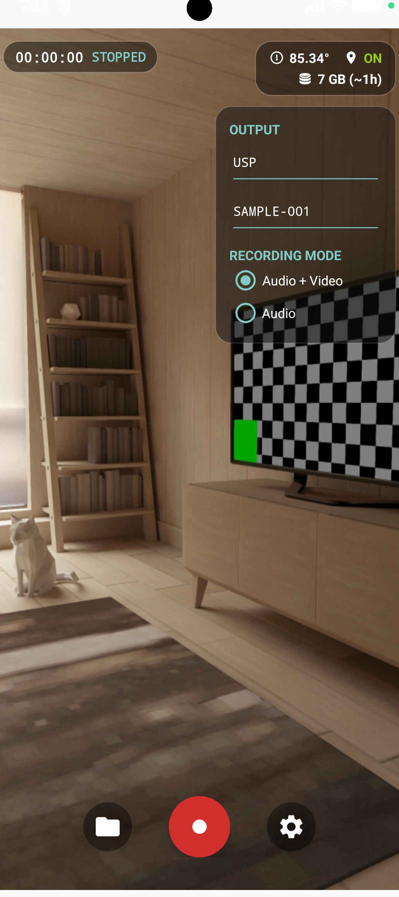
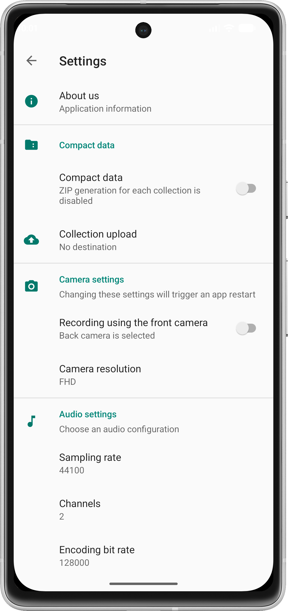
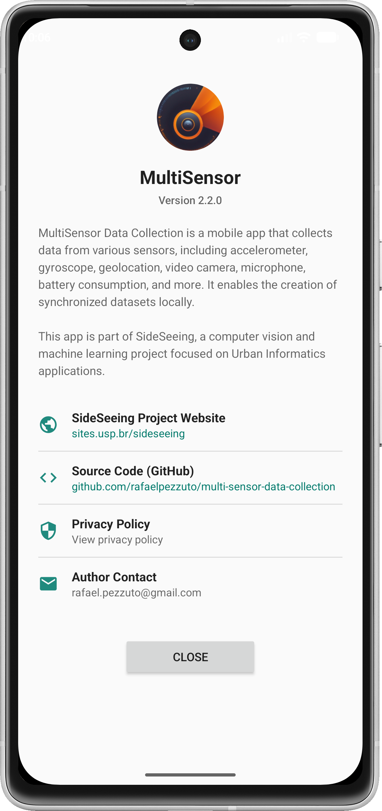
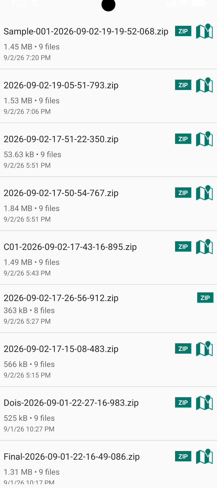
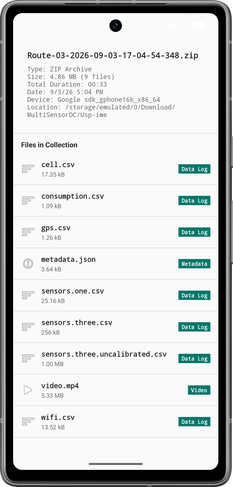
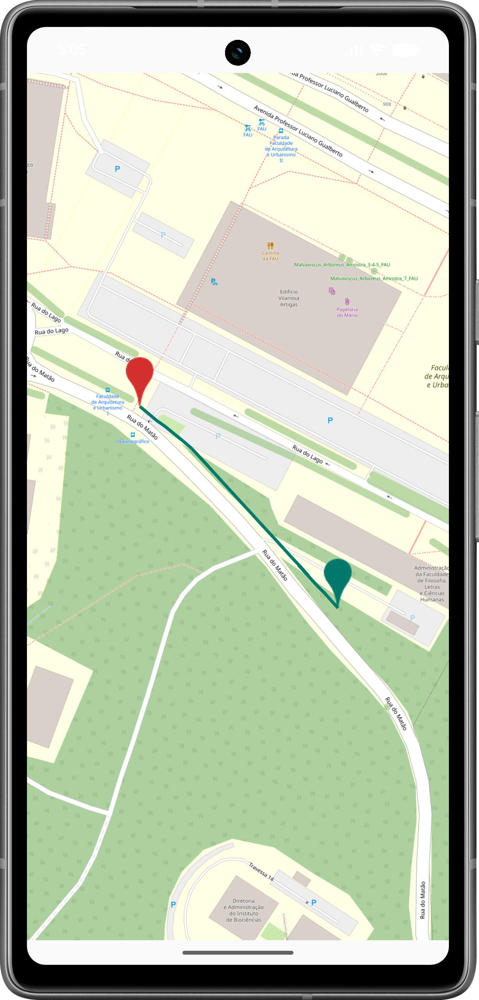
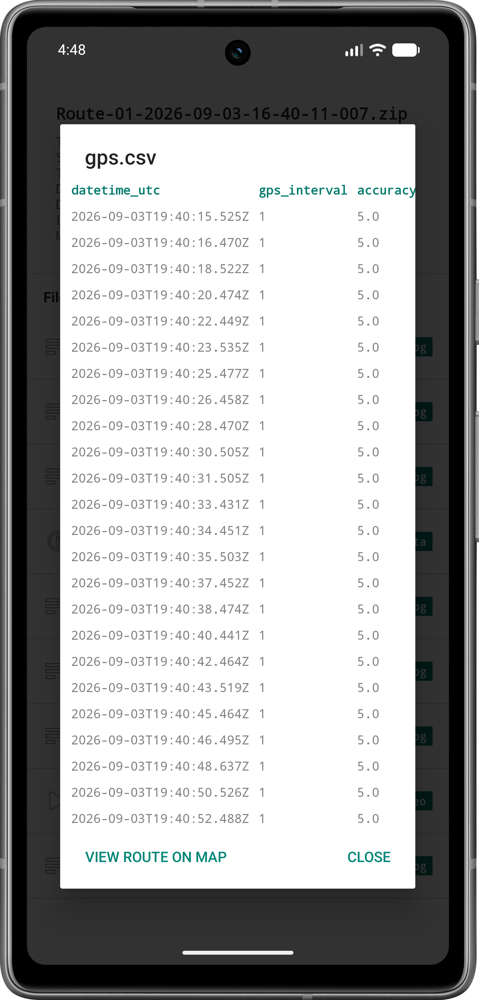

# MultiSensor Data Collection

[](https://developer.android.com)
[](https://kotlinlang.org)
[](https://github.com/rafaelpezzuto/multi-sensor-data-collection)

MultiSensor Data Collection is an open-source Android application designed for high-precision, multi-sensor dataset acquisition. The application synchronously records and structures local data from mobile sensors—including video camera, microphone, accelerometer, gyroscope, magnetometer, gravity, light, geolocation (GPS), battery consumption, and network signals—producing synchronized multimodal datasets for urban informatics, computer vision, and machine learning research.

---

## Features

- **Synchronized Video & Audio Recording**: High-definition video recording (SD, HD, FHD, 4K) via Jetpack CameraX with configurable frame rates, audio sampling rates, and channels.
- **Camera Pinch-to-Zoom**: Dynamic gesture zoom control with bounded zoom ratios.
- **Multi-Sensor Logging**: High-frequency logging for motion sensors (accelerometer, gyroscope, magnetometer, gravity), light, pressure, and step counters.
- **Geolocation Tracking**: High-accuracy GPS tracking (`gps.csv`) paired with an in-app interactive map (OpenStreetMap) displaying route polylines, departure/arrival markers, and timestamp/accuracy metadata.
- **Data History & In-App Inspection**:
  - **Dataset List**: Local collection management for ZIP archives and uncompressed directories.
  - **Media Player**: Full-screen video and audio player.
  - **CSV Inspector**: Scrollable table view for sensor CSV files with highlighted headers.
  - **JSON Inspector**: Formatted view for metadata JSON files.
- **Real-Time Disk Space & Recording Estimation**: Live storage monitoring with dynamic recording time estimation based on selected resolution and audio/video mode.
- **Battery & Network Diagnostics**: Periodic logging of battery consumption metrics and Wi-Fi / Cellular network scans.
- **Upload to S3-Compatible Storage**: Resumable, verified uploads to RustFS, MinIO, Ceph, Cloudflare R2, Backblaze B2, Wasabi or AWS S3, from the app or automatically in background.

---

## Screenshots

|  |  |
|:---:|:---:|
| **Main Recording Screen** | **Settings Screen** |

|  |  |
|:---:|:---:|
| **About Screen** | **Saved Data History** |

|  |  |
|:---:|:---:|
| **Collection Details** | **GPS Route Map Visualization** |

|  |
|:---:|
| **CSV Data Inspection** |

---

## Dataset Structure

Each collection run produces a structured dataset directory (or `.zip` archive) formatted as follows:

```text
MultiSensorDC/<dataset_name>/
├── video.mp4               # Synchronized video stream
├── audio.m4a               # Audio recording (in audio-only mode)
├── metadata.json           # System metadata, sensor parameters, and UTC timestamps
├── accelerometer.csv       # timestamp_utc, timestamp_nanos, x, y, z
├── gyroscope.csv           # timestamp_utc, timestamp_nanos, x, y, z
├── magnetometer.csv        # timestamp_utc, timestamp_nanos, x, y, z
├── gravity.csv             # timestamp_utc, timestamp_nanos, x, y, z
├── gps.csv                 # datetime_utc, gps_interval, accuracy, latitude, longitude
├── battery.csv             # timestamp_utc, battery_level, temperature, voltage
└── network.csv             # timestamp_utc, wifi_ssid, bssid, rssi, cellular_info
```

---

## Uploading to S3-Compatible Storage

Collections can be uploaded directly from the phone to any S3-compatible object store.

1. **Settings → S3 Destinations → Add destination.** Enter the endpoint (`https://` only), region, bucket and the access key and secret. Credentials are encrypted with a key held in the Android Keystore, are never shown again, and are excluded from backups and from `metadata.json`.
2. **Test connection** writes, lists and deletes a small test object and checks multipart uploads, which resuming needs.
3. **Settings → Active S3 destination** selects where *Sync* uploads. "Off" keeps using the server URL or storage folder.

Each collection becomes one object per file under the **object key template**, with `metadata.json` uploaded last so its presence marks a complete capture. Placeholders are `{directory}`, `{subdirectory}`, `{dataset}` (folder name) and `{timestamp}` (capture time); for example `sao-paulo/bras/raw/{subdirectory}/{timestamp}`. With **Upload as zip**, or for collections already stored as `.zip`, each collection is one `.zip` object.

| Provider | Endpoint | Region | Path-style |
|---|---|---|---|
| RustFS, MinIO, Ceph RGW | your server, e.g. `https://s3.example.org` | `us-east-1` unless configured | on |
| Cloudflare R2 | `https://<account-id>.r2.cloudflarestorage.com` | `auto` | on |
| Backblaze B2 | `https://s3.<region>.backblazeb2.com` | e.g. `us-west-004` | on |
| Wasabi | `https://s3.<region>.wasabisys.com` | e.g. `us-east-1` | on |
| AWS S3 | `https://s3.<region>.amazonaws.com` | e.g. `sa-east-1` | off |

Self-hosted servers with a self-signed or private certificate can pin it under **Server certificate** after checking its SHA-256 fingerprint.

**Reliability.** Files larger than the part size (16 MiB by default) are sent as multipart uploads; each part is retried on its own with backoff, and the upload state is saved after every part, so an upload interrupted by a lost connection, a killed app or a reboot resumes instead of starting over. Interrupted syncs finish in background under the network and charging conditions set in Settings; **Upload automatically in background** (off by default) also uploads every new collection after recording.

**Integrity and idempotency.** Every request carries `Content-MD5` and a signed SHA-256 of its body, so the server rejects corrupted parts. Each object stores its whole-file MD5 as `x-amz-meta-md5chksum` (the same metadata rclone writes) and is verified with `HEAD` after upload. An object that already exists with the same size and checksum is skipped, including ones uploaded with rclone; a different one is never replaced unless **Overwrite existing objects** is on.

**Server-side setup.** The access key needs `s3:PutObject`, `s3:GetObject`, `s3:ListBucket`, `s3:ListMultipartUploadParts` and `s3:AbortMultipartUpload` on the bucket or prefix (`s3:DeleteObject` only for *Test connection*). Add a lifecycle rule that aborts incomplete multipart uploads after a few days, so uploads abandoned by an uninstalled app are cleaned up.

To run the client's integration tests against a server, set `MSDC_S3_ENDPOINT`, `MSDC_S3_BUCKET`, `MSDC_S3_ACCESS_KEY`, `MSDC_S3_SECRET_KEY` (and optionally `MSDC_S3_REGION`, `MSDC_S3_PREFIX`) before `./gradlew app:testDebugUnitTest`. For a local server you can start MinIO with `docker run -p 9000:9000 minio/minio server /data`.

---

## Building and Installation

### Requirements
- **JDK**: 21
- **Android SDK**: Target SDK 36 (Android 15+), Min SDK 26 (Android 8.0+)
- **Gradle**: 9.5+ with Version Catalog (`gradle/libs.versions.toml`)

### Compilation Commands

```bash
# Build Debug APK
./gradlew app:assembleDebug

# Execute Unit Tests
./gradlew app:testDebugUnitTest

# Build Release App Bundle (AAB)
./gradlew app:bundleRelease
```

---

## Research Context: SideSeeing Project

This application is developed as part of the **SideSeeing Project** at the **Institute of Mathematics and Statistics of the University of São Paulo (IME-USP)**.

SideSeeing investigates computer vision, sensor fusion, and machine learning methods for Urban Informatics, focusing on urban accessibility, sidewalk quality, and infrastructure assessment.

For further details regarding the research initiative, visit [SideSeeing Project](https://sites.usp.br/sideseeing).

---

## Authors and Citation

- **Alyssa Florence** / IME-USP
- **Rafael Jeferson Pezzuto Damaceno** / IME-USP (*rafael.pezzuto@gmail.com*)
- **Roberto Marcondes Cesar Jr.** / IME-USP
